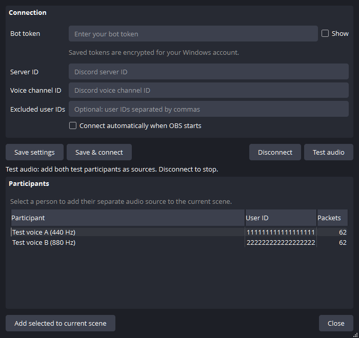

# VC Mix

**Separate Discord voices. Separate OBS controls.**

VC Mix is a Windows OBS Studio plugin that captures each participant in a Discord voice channel as an independent audio source. Give each voice its own volume, mute, filters, monitoring and recording-track assignments without virtual audio cables.

[Download the Windows installer](https://github.com/RobertTGreat/VC-Mix/releases/latest) · [Build from source](docs/building.md)

## Features

- One OBS audio source per Discord participant, bound to their user ID.
- A native Qt settings window that follows OBS's theme and display scaling.
- Bot-token setup, automatic connection and optional excluded user IDs.
- Built-in test audio for checking independent sources without Discord credentials.
- Local reception and decoding, with tokens encrypted using Windows DPAPI.

## Requirements

Windows 10 or 11, x64, and OBS Studio. This release is built and tested with **OBS 32.1.2 / Qt 6.8.3**. Other OBS versions, ARM64, macOS and Linux have not been validated.

The installer includes the receiver runtime. You do not need Node.js, Python or virtual audio cables to use the plugin.

## Install

1. Close OBS Studio.
2. Download `VC-Mix-0.1.0-Windows-x64-Setup.exe` from [Releases](https://github.com/RobertTGreat/VC-Mix/releases/latest).
3. Run the installer and approve its administrator prompt.
4. Open OBS and select **Tools → VC Mix…**.

The installer uses OBS's standard Windows plugin directory: `%PROGRAMDATA%\obs-studio\plugins\vc-mix`. It includes an uninstaller available through Windows Installed apps. The current release is unsigned.

For a manual installation, extract the release ZIP and copy the `vc-mix` folder into `%PROGRAMDATA%\obs-studio\plugins`. The ZIP is also suitable for arranging files for a custom OBS installation; OBS portable mode uses its own plugin paths.

## Connect Discord

1. Create a bot in the [Discord Developer Portal](https://discord.com/developers/applications) and invite it to your server with **View Channels** and **Connect** permissions. No privileged intents or message-content access are required.
2. Enable Discord's **Developer Mode**, then copy the server ID and voice channel ID.
3. In **Tools → VC Mix…**, enter the bot token and IDs. Optionally exclude your own user ID if OBS already captures your microphone.
4. Choose **Save & connect**. The bot joins self-muted, with reception enabled.
5. Select a participant and choose **Add selected to current scene**. Repeat for each voice.

Use a bot token, never a personal Discord account token. Tell participants when their audio is being captured. Regular server voice channels are supported; direct calls and Stage channels are not.

An existing text bot may share the token. Only one voice receiver should connect that bot to a particular server at a time.

## Use in OBS

Each **VC Mix Participant** source supports OBS's normal audio controls. Sources can also be added from **Sources → + → VC Mix Participant**.

Choose recording tracks in **Advanced Audio Properties** and enable those tracks in **Settings → Output → Recording**. OBS supports six recording tracks. More participants can have separate mixer sources, but independent recording tracks still share that limit.

Use **Test audio** to generate separate 440 Hz and 880 Hz participants without credentials. **Disconnect** stops reception or test audio. Closing the settings window keeps capture running.

Avoid recording Discord's normal mixed output alongside the same isolated voices. Use OBS monitoring if you want to hear the participant sources through your headphones.

## Settings and updates

Credentials are saved under `%APPDATA%\obs-studio\plugin_config\vc-mix\settings.json`. Tokens are encrypted for the current Windows account; scene collections store participant IDs and names.

Participant sources recover when a person rejoins with the same user ID. Updating preserves settings and scene bindings. Earlier builds named Discord Voice are migrated automatically on the same Windows account.

Uninstalling removes the plugin and receiver, while retaining saved settings. Delete the configuration folder above if you also want to remove saved credentials.

## Troubleshooting

- **No participants:** check the server/channel IDs, channel permissions and that the bot is not server-deafened.
- **No mixer audio:** add the participant source to a scene and check its mute, volume and track assignments. Try **Test audio** first.
- **Connection error:** correct the settings shown in the window and reconnect. Restart OBS after updating the plugin.
- **Plugin missing:** confirm the complete `vc-mix` folder was installed and that your OBS/Qt versions match the tested requirements.

Discord voice reception depends on upstream libraries and can change with Discord updates. When opening an issue, include OBS's version and the error text, with tokens and identifying information removed.

## Development

See [building and testing](docs/building.md). The optional [standalone receiver](docs/standalone.md) supports virtual-device routing for development.

## License

[GPL-2.0-or-later](LICENSE). Bundled dependencies retain their own licenses; see [third-party notices](THIRD_PARTY_NOTICES.md).

VC Mix is an independent project and is not affiliated with Discord or the OBS Project.
